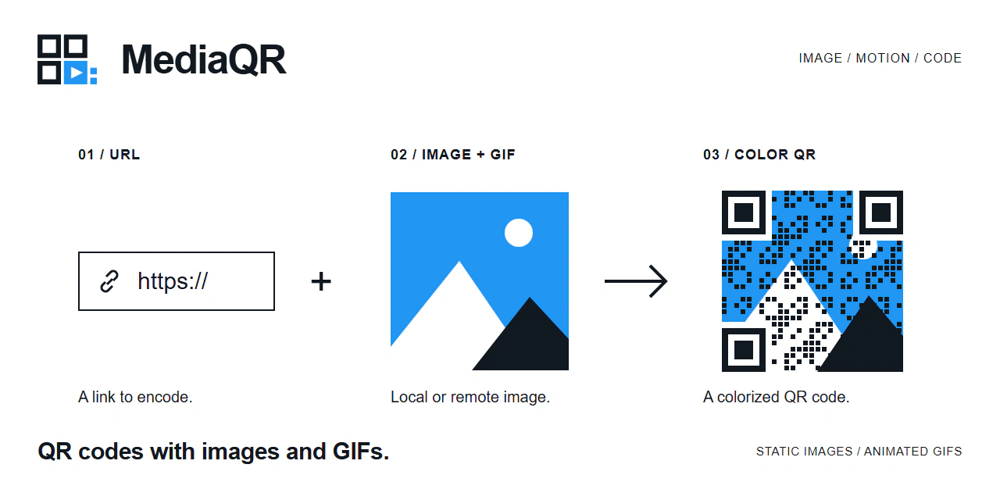
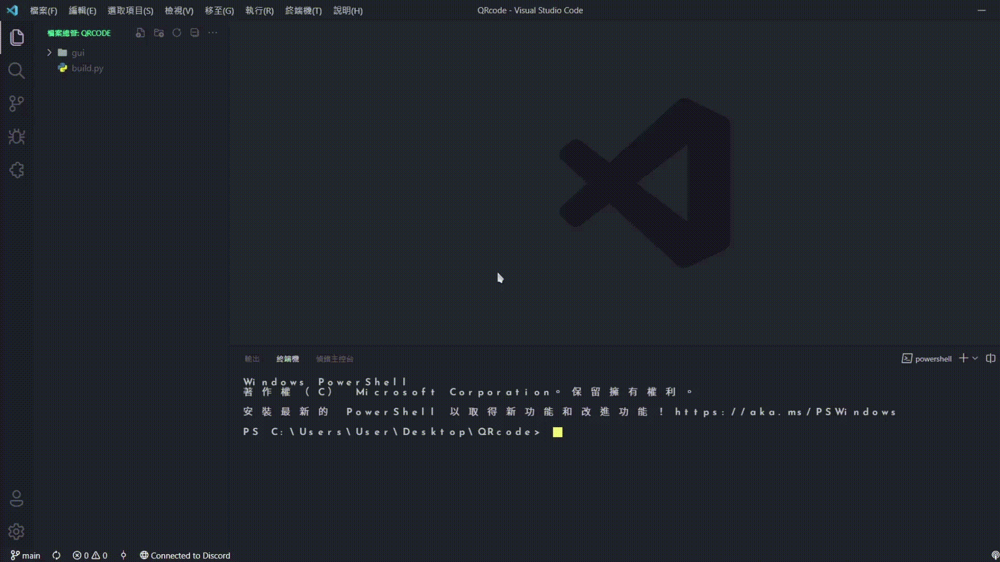
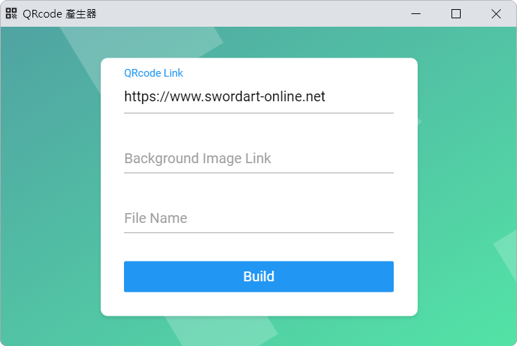
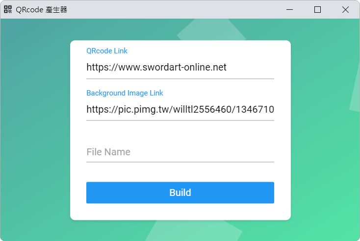
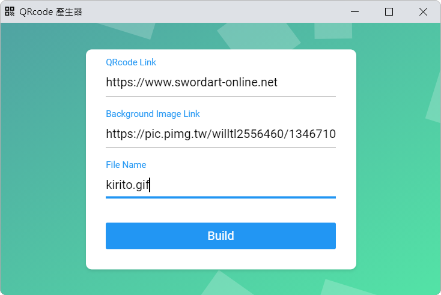
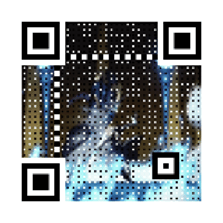

# MediaQR



MediaQR is a Python desktop utility for creating colorized QR codes with local or remote static images and animated GIFs as backgrounds. It uses MyQR for QR code generation, Eel for the HTML-based interface, Requests to download remote media, and OpenCV to preview static output.



## Features

- Encodes a URL in a colorized QR code
- Accepts local image paths and HTTP(S) image URLs
- Supports static images and animated GIF backgrounds
- Saves the result with a user-defined file name
- Opens static output in an OpenCV preview window and animated GIF output in the default Windows app
- Runs an HTML, CSS, and JavaScript interface through Eel

## Requirements

- Python 3.12 (tested with Python 3.12.13)
- Python packages listed in `requirements.txt`

The tested dependency versions are pinned in `requirements.txt`:

- MyQR 2.3.1
- Requests 2.33.1
- Eel 0.18.2
- OpenCV Python 5.0.0.93

## Setup

Install the required packages from the repository root:

```bash
python -m pip install -r requirements.txt
```

## Run the application

Run the command from the repository root:

```bash
python build.py
```

The interface opens in a `600 x 400` Microsoft Edge window at local port `8763`.

## Usage

1. Enter the URL to encode.

   

2. Enter a local image path or an HTTP(S) image URL.

   

3. Enter the output file name. When the background is an animated GIF, use a `.gif` output extension.

   

4. Select **Build** to generate the QR code.

   

Static output opens in an OpenCV preview window. Animated GIF output opens in the default Windows app so the animation can be displayed.

## How it works

The browser interface calls the exposed Python function `buildQRcode()` through Eel. Remote images are downloaded with Requests and stored as `picData.webp` or `picData.gif` in the repository root.

The image is then passed to `myqr.run()` with color output enabled and the QR version fixed at `20`. The generated file uses the name entered in the interface. Static output is displayed with OpenCV, while animated GIF output is opened with its default Windows app.

## Known limitations

- Inputs are passed to Python without explicit validation or visible error reporting.
- Remote image requests do not set a timeout or check the HTTP response status.
- Each remote image download overwrites the existing `picData.webp` or `picData.gif`.
- The application is configured specifically for Microsoft Edge and uses a native OpenCV window for previews.
